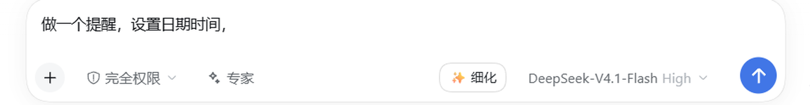

# 一句话细化 · dsh-prompt-detailer

[](https://www.npmjs.com/package/dsh-prompt-detailer)
[](https://www.npmjs.com/package/dsh-prompt-detailer)
[](LICENSE)
[](https://github.com/deepseek-ai/deepseek-harness)

**在 DSH 输入框里点一下，把「帮我做个 XX」这种粗需求，先交给一个便宜的 AI 写成详细、可执行的提示词，再交给主 Agent 干活。**

主模型只负责执行，不再被含糊需求来回消耗 token。



> 适用于 [DeepSeek Harness](https://github.com/deepseek-ai/deepseek-harness)（DSH）0.2.x。  
> 不绑定任何一家模型：火山方舟、OpenAI、Ollama、LiteLLM、one-api、vLLM 等 OpenAI 兼容接口都能用。

---

## 为什么

大多数「帮我做个 XX」的请求，缺少目标、输入、步骤、输出格式和验收标准。直接发给 Agent，它要么反问，要么自己猜，来回几轮都在烧主模型 token。

这个插件把「写清楚」这一步外包给一个更便宜/更快的模型：

1. 在输入框写下粗需求；
2. 点 **✨ 细化**；
3. 预览结构化提示词，可编辑；
4. 点 **填入并发送**，主 Agent 直接开工。

---

## 功能

- **✨ 细化按钮**：输入框右侧、发送按钮附近，随时可用
- **流式预览**：后端支持 SSE 时边生成边显示，不必干等一整段
- **预览与编辑**：改写结果先在浮层里给你看，不满意可以直接改
- **填入 / 填入并发送**：只回填草稿，或直接作为下一轮任务提交
- **原文对照**：结果页可展开原始需求，一键「恢复原文」；也可切换**并排对照**
- **等待计时 + 取消**：加载时显示已等待秒数，随时取消、原文不动
- **首次示例**：没思路时点「记账插件 / 生成周报 / 重构代码」快速填入
- **可配置后端**：任意 OpenAI 兼容的 `/chat/completions` 地址、模型、API Key、超时
- **后端预设**：本地 8000、Ollama 11434、火山方舟
- **状态检测**：自动探测常见本地端口，显示「已连接 / 未连接」
- **Agent 工具**：`refine_prompt`，主 Agent 也可以在需要时主动调用同一套改写流水线

---

## 安装

npm（推荐，发布后可用）：

```sh
dsh plugin --profile web add dsh-prompt-detailer
```

GitHub 源码安装：

```sh
dsh plugin --profile web add github:YoungerHy/dsh-prompt-detailer
```

本地目录安装（开发/试用）：

```sh
dsh plugin --profile web add ./dsh-prompt-detailer
```

装完重启 DSH（或刷新页面），输入框右侧会出现 **✨ 细化**。

> 桌面端的 profile 名通常是 `desktop`；把命令里的 `web` 换成 `desktop` 即可。

---

## 配置后端

插件本身不带模型。首次打开浮层时，底部 **后端设置** 里填：

| 字段 | 说明 |
|---|---|
| 后端地址 | OpenAI 兼容根地址，例如 `http://127.0.0.1:8000/v1`、`https://ark.cn-beijing.volces.com/api/v3` |
| 模型 | 该后端上的模型名，例如 `gpt-4o-mini`、`qwen2.5:7b`、方舟推理接入点 `ep-2026xxxx` |
| API Key | 本地服务通常留空；官方 API 填对应 Key。已保存的 Key 不会回显，留空保持不变，点「清除」可删除 |
| 超时 (ms) | 默认 90000；慢模型可调到 180000 |

也可以直接改配置文件（首次加载自动生成）：

```
~/.dsh/prompt-detailer/config.json
```

```json
{
  "baseUrl": "http://127.0.0.1:8000/v1",
  "model": "gpt-4o-mini",
  "apiKey": "",
  "timeoutMs": 90000,
  "temperature": 0.3,
  "maxTokens": 2400,
  "systemPrompt": "你是资深提示词工程师……"
}
```

环境变量可临时覆盖文件：`DSH_PROMPT_DETAILER_BASE_URL`、`DSH_PROMPT_DETAILER_MODEL`、`DSH_PROMPT_DETAILER_API_KEY`。

### 后端示例

**火山方舟（官方）**

- 地址：`https://ark.cn-beijing.volces.com/api/v3`
- 模型：你的推理接入点 ID（`ep-...`）或模型 ID
- Key：方舟 API Key

**OpenAI**

- 地址：`https://api.openai.com/v1`
- 模型：`gpt-4o-mini`
- Key：`sk-...`

**Ollama（本地免费）**

- 地址：`http://127.0.0.1:11434/v1`
- 模型：`qwen2.5:7b`（按你本地已拉取的模型改）
- Key：留空

**LiteLLM / one-api / vLLM / LM Studio**

- 地址：你的网关 `/v1`
- 模型：网关里的模型名
- Key：网关要求就填

---

## 使用

1. 输入框写粗需求：`帮我做个记账插件，能记每天的花销，月底能看汇总`
2. 点 **✨ 细化**
3. 首次使用先在 **后端设置** 里填地址/模型，点 **保存设置**，再点 **测试连接**
4. **开始细化** → 等 10–30 秒（支持 SSE 的后端会边生成边显示）
5. 结果页：
   - **填入并发送**：替换草稿并提交，主 Agent 立即执行
   - **仅填入**：只替换草稿，你自己检查后再发
   - **并排对照**：左边原始需求、右边改写结果，方便逐句比对
   - **复制** / **重新细化**

### Agent 工具

`refine_prompt`：

```json
{ "text": "用户的原始需求", "extra": "可选的补充要求" }
```

返回 `prompt`（改写后的提示词）、`model`、`backend`、`elapsedMs`。工具不会提交对话。

---

## HTTP 接口

供 Web 客户端同源调用，仅监听本机 DSH 回环：

| 方法 | 路径 | 用途 |
|---|---|---|
| POST | `/prompt-detailer/refine` | `{ "text": "..." }` → JSON，改写后的提示词 |
| POST | `/prompt-detailer/refine-stream` | 同上，返回 `text/event-stream`：`delta` 事件逐段推送，最后 `done` |
| GET | `/prompt-detailer/config` | 读取当前配置（`apiKey` 恒为空，另有 `apiKeySet`） |
| POST | `/prompt-detailer/config` | 保存部分配置字段；`apiKey` 留空表示保留原 Key，传 `null` 表示清除 |
| GET | `/prompt-detailer/status` | 探测当前后端与常见本地端口 |

---

## 已验证

- 真实豆包（本机 `127.0.0.1:8765`）：约 18 秒返回 957 字，输出以「你是记账插件开发 AI Agent…」开头，包含目标 / 任务 / 步骤 / 验收 / 待确认，不再是 PRD。
- 事件流已实测：本机豆包 relay 会把整段结果缓冲后一次性发出（首段 11.2 秒、总时长 11.2 秒）；直接支持 SSE 的 OpenAI / 方舟 / Ollama 会边生成边显示。非流式后端会自动退回「一次给完整结果」。
- 跑的时候发现一个关键问题：部分本地 relay 会丢掉 `system` role，模型会把「细化需求」直接当成「写需求文档」。现在把改写指令同时写进 user message，system 兼容的接口也不受影响。
- mock 401 / 404 / 429 / 500 都会映射成可操作的中文错误；SSE 分段、CRLF、跨 chunk 分隔符、`[DONE]` 后保持连接、非 SSE 回退、配置写入/读取、空输入、20001 字超长、后端离线、工具注册均有测试。
- Web 客户端注册与首帧渲染 smoke 测试通过；真实页面里的按钮/浮层需要安装后在页面里确认。

---

## 兼容性

- DSH 0.2.x（`dsh.engines` 声明为 `>=0.2.1-rc.2 <0.3.0`）
- 使用 `conversation.input.right` 槽位与 `inputActions.setDraft/submit`
- 无构建步骤：`index.js`（Host，纯 ESM）+ `client.js`（Web，ModuleLoader 格式）
- 不修改 DSH 源码，不引入额外运行时依赖

---

## 隐私与安全

- 草稿会发送到**你自己配置的后端**；插件本身不上传任何数据、不包含遥测。
- `apiKey` 以明文保存在本机 `~/.dsh/prompt-detailer/config.json`；这是本机个人配置，请勿提交到仓库或分享。浏览器端的 `GET /config` 不会返回真实 Key，只返回 `apiKeySet`。
- 所有 HTTP 路由只供本机 DSH 页面同源调用；默认后端也是 `127.0.0.1`。
- 使用第三方模型服务时，请自行确认其隐私政策与计费方式。

---

## 开发

```sh
# 语法检查（无构建步骤）
node --check index.js
node --check client.js

# 本地目录安装
dsh plugin --profile web add ./dsh-prompt-detailer
```

文件结构：

```
dsh-prompt-detailer/
├── package.json        # bundle + Web client 声明
├── cordis.patch.yml    # 插入 prompt-detailer 宿主行
├── index.js            # Host：配置、HTTP 路由、refine_prompt 工具
├── client.js           # Web：✨ 一句话细化按钮 + 预览浮层 + 后端设置
├── locale/zh.json      # 插件市场显示元数据
├── locale/en.json
├── icon.svg
├── LICENSE
├── PUBLISH.md          # 发布到 npm / GitHub / 插件市场的步骤
└── VIDEO-SCRIPT.md     # 抖音/视频号介绍视频脚本
```

## License

MIT
